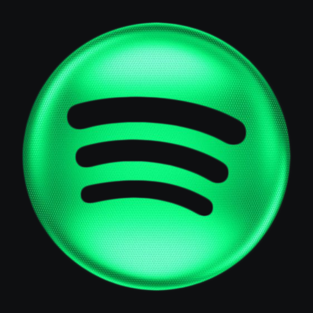

# SpotiBacán para Nintendo Switch

Cliente de Spotify para la Switch con Atmosphère: tu biblioteca, listas, letras sincronizadas, música de fondo mientras juegas (overlay de Ultrahand) y **descarga de canciones a la SD para escucharlas sin internet**.

Es la versión para Switch de [SpotiBacán para 3DS](https://github.com/ohquebacan/spotibacan).

## Instalación

Descarga `SpotiBacan.zip` de [Releases](https://github.com/ohquebacan/SpotiBacan-NX/releases) y extráelo en la raíz de la SD (o instálalo desde OQB Updater). Reinicia una vez para que arranque el servicio de fondo.

Requiere una cuenta **Premium**. Spotify niega el audio a algunas cuentas Premium creadas hace poco; si todas las canciones fallan, probablemente es eso.

## Descargas

En cualquier lista, **Descargar** baja las canciones que todavía no están en la SD a `sdmc:/music/SpotiBacan/Artista/Álbum/`. La biblioteca de la app ya lee esa carpeta, así que suenan sin internet.

## Compilar

`./docker_build.sh` (Docker con devkitPro: switch-dev, switch-sdl2, switch-ffmpeg, switch-curl, switch-mbedtls y switch-libjpeg-turbo).

## Créditos y licencia

Basado en [NXtify](https://github.com/noesio582-boop/NXtify) (noesio582-boop), que a su vez es un fork de [Switify](https://github.com/DomazinUS/Switify) (HiroshiYamauchi). Usa [cspot](https://github.com/feelfreelinux/cspot), la interfaz de [Songate](https://github.com/AndryTheBeast/Songate) (AndryTheBeast) y [libultrahand](https://github.com/ppkantorski/libultrahand) (ppkantorski). El README original está en [README-NXtify.md](README-NXtify.md).

GPL-3.0-or-later (el overlay, GPL-2.0-only). Ver [LICENSE](LICENSE) y [LICENSES](LICENSES/).
